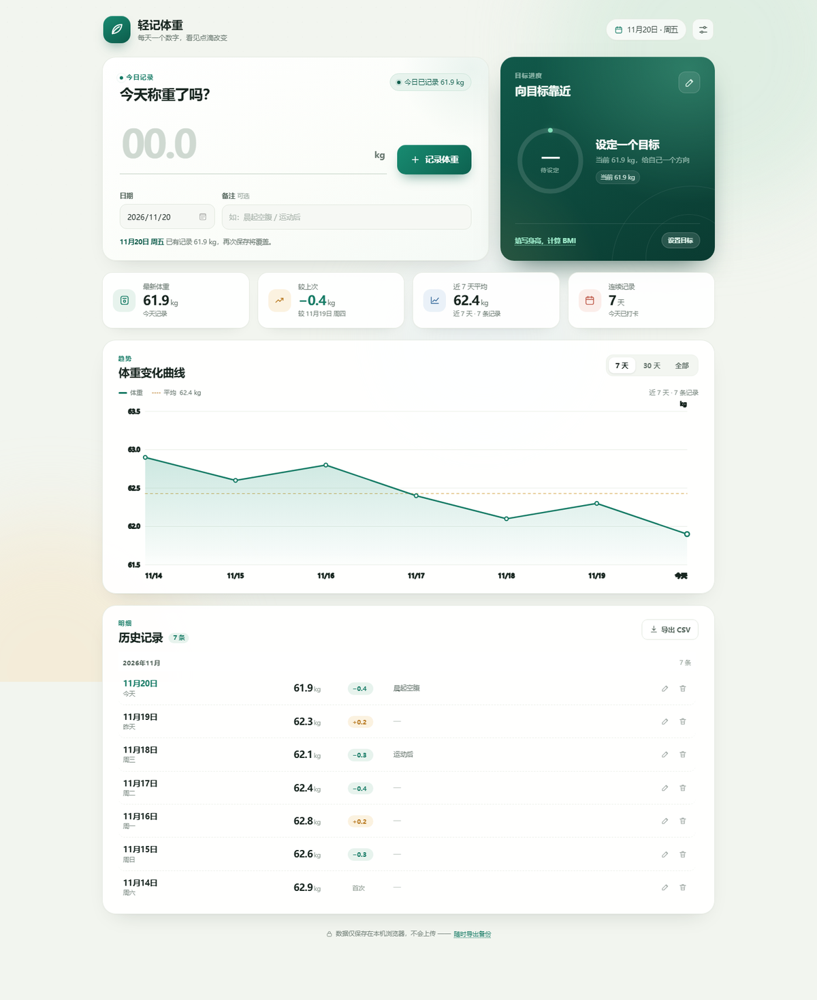

# 轻记体重

一个纯前端、零依赖的每日体重记录网页。打开就能用，数据只保存在你自己的浏览器里。



## 功能

- **记录今日体重**：输入体重即可保存，支持一位小数；同一天重复记录会覆盖当天数据。
- **补记与修改**：可以选择过去日期补记；在历史列表里点击编辑按钮可修改记录，点击删除需二次确认。
- **趋势曲线**：7 天 / 30 天 / 全部三种范围，支持悬停查看日期、体重和备注；有数据时会自动显示近期范围。
- **数据概览**：最新体重、较上次变化、近 7 天平均、连续记录天数。
- **目标进度**：设置目标体重后，按第一条记录为起点计算完成百分比和剩余重量；设置身高后可计算 BMI。
- **本地保存**：数据写入浏览器 `localStorage`，刷新、关闭页面后仍然保留，不会上传到任何服务器。
- **导出备份**：历史记录和设置弹窗中都可以导出 CSV，Excel/WPS 可直接打开。
- **响应式布局**：桌面、平板和手机端都已适配。

## 使用方式

### 方式一：直接打开

双击 `index.html`，使用 Chrome、Edge 或 Firefox 打开即可。已在 Edge 下验证：直接以 `file://` 方式打开时本地存储和刷新持久化均正常。

### 方式二：本地静态服务器（可选）

如果浏览器对本地文件做了额外限制，可以在该目录下启动一个静态服务器：

```bash
# 任选其一
python -m http.server 8000
npx serve .
```

然后访问 `http://localhost:8000/`。

## 数据说明

- 存储键：`qingji-weight:v1`，保存格式为 JSON，包含 `records` 和 `profile`。
- 清除浏览器站点数据、使用隐私模式或无痕窗口时，记录可能被清除。建议定期导出 CSV。
- CSV 文件带 UTF-8 BOM，中文备注在 Excel 中不会乱码。
- 若在某个浏览器中禁用了站点存储，页面会提示「浏览器存储不可用」，此时记录只在当前页面内有效。

## 文件结构

```text
weight-tracker/
├── index.html   # 页面结构
├── styles.css   # 视觉样式与响应式布局
├── app.js       # 本地存储、统计、趋势图、导入导出等逻辑
├── preview.png  # 页面预览图
└── README.md
```

## 实现说明

- 原生 HTML / CSS / JavaScript，无构建步骤、无第三方依赖、无需联网。
- 趋势图使用原生 SVG 绘制，支持按时间范围缩放、悬停提示和自适应重绘。
- 日期按本地时区处理，避免跨时区导致记录错日。
- 数据校验：体重范围 20–300 kg，身高范围 100–250 cm，日期不能晚于今天。
